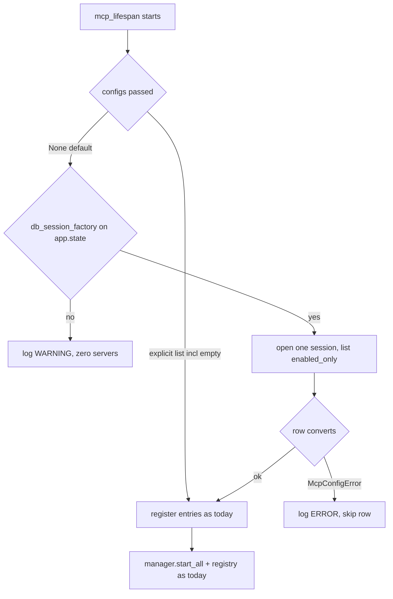

# Design — MCP Server Config Persistence (Issue #21)

> Branch: `feature/mcp-server-config-persistence` · Draft PR: #144 · TODO MCP #7
> Date: 2026-11-15 · Status: Approved

## Problem

MCP server configurations currently exist only as constructor arguments to
`mcp_lifespan`, which defaults to an empty fleet: Octave always boots with zero
MCP servers. The `mcp_servers` table already shipped (ORM in
`octave/db/models/mcp.py`, initial Alembic migration) but has no read or write
path. Both `octave/mcp/config.py` and `octave/mcp/lifespan.py` docstrings
explicitly anticipate this work item ("populated from the unified database at
the composition root later (roadmap #7)").

## Goal

Persist MCP server configurations (name, transport, endpoint, arguments) in the
unified database, and load them at startup so Octave boots with its configured
fleet.

## Scope

**In:** DB-layer CRUD store, `headers` column + migration, startup loading in
`mcp_lifespan`, tests.

**Out (explicit):** REST endpoints and UI (deferred to the MCP Connector UI
work item), runtime hot-reload (config edits take effect on next restart),
per-user scoping (`mcp_servers` rows are instance-global), import/export.

## Decisions (from brainstorming)

1. **No HTTP surface.** DB-layer store + startup loading only. The UI work item
   adds REST CRUD later on top of this store.
2. **Plane-owned store.** `McpConfigStore` lives in `octave/mcp/config_store.py`
   (the `AuthStore` pattern), not in `octave.db`. Rationale: the row→
   `ServerConfig` conversion is mcp-plane knowledge, and `octave.db` must not
   import planes (dependency-direction rule, cf. "`octave.db` never imports
   `octave.inference`"). `octave.db` stores (`VaultStore`, `EventStore`) exist
   only where a storage-engine invariant (vec mirror, seq ordering) demands it;
   plain CRUD does not earn a `db`-package residence (ADR 2026-09-13: "per-table
   CRUD is NOT wrapped in repositories").
3. **Lifespan reads the DB itself.** When `configs` is not passed,
   `mcp_lifespan` reads enabled rows via `app.state.db_session_factory`.
   `app.py` stays untouched (`db_lifespan` already composes before
   `mcp_lifespan`). Rejected: pluggable config-source callback (seam with one
   implementation), app.py-side fetching (import-time async composition is
   awkward).
4. **CRUD surface:** `create` + `update` + `delete` + `get`/`list_servers` +
   `set_enabled`. Explicit create, id-based addressing, targeted enable/disable
   toggle. `update` replaces exactly the fields provided (`None` = leave
   unchanged); a provided `config` replaces the whole transport column set.
5. **Errors:** new `McpServerNameTaken(McpError)` for unique-name collisions;
   reuse `McpConfigError` for shape/coherence violations. Both in
   `octave/mcp/errors.py`.
6. **`headers` column now.** `HttpConfig.headers` gets a nullable JSON column
   via a small Alembic migration — full round-trip fidelity for both transports
   (the UI work item needs it immediately; deferring would strand HTTP auth
   headers).
7. **Skip-and-log startup posture.** Extends the shipped decision (spec
   decision 6): peripheral servers never abort boot. A corrupt row is logged
   ERROR and skipped — one bad row must not prevent the fleet from booting
   (context-injection JSON-tolerance precedent). A missing
   `db_session_factory` logs WARNING and boots zero servers.

## Design

### 1. Schema — one column, one migration

`octave/db/models/mcp.py` — add to `McpServer`:

```python
headers: Mapped[dict[str, str] | None] = mapped_column(JSON)
```

Nullable; stdio rows leave it NULL (the existing `CHECK` constraint is
untouched — it governs `command`/`url` shape only). One Alembic revision with a
single `op.add_column("mcp_servers", ...)`; downgrade drops it. The existing
model-vs-migration equivalence test (`tests/db/test_migrations.py`) pins schema
and model together.

### 2. `McpConfigStore` — `octave/mcp/config_store.py`

Constructed with one `AsyncSession`; **never commits** (callers own transaction
boundaries — the `VaultStore`/`AuthStore` contract). Input vocabulary is the
domain union `ServerConfig`; an `isinstance` branch derives the transport
columns, so shape coherence is enforced by types at write time, mirroring the
DB `CHECK`.

```python
@dataclass(frozen=True)
class McpServerEntry:
    id: str
    name: str
    enabled: bool
    config: ServerConfig  # StdioConfig | HttpConfig, reconstructed from columns

class McpConfigStore:
    def __init__(self, session: AsyncSession) -> None: ...

    async def create(
        self, *, name: str, config: ServerConfig, enabled: bool = True
    ) -> McpServerEntry
    async def update(
        self,
        server_id: str,
        *,
        name: str | None = None,
        config: ServerConfig | None = None,
        enabled: bool | None = None,
    ) -> McpServerEntry | None  # None if id absent
    async def delete(self, server_id: str) -> bool  # False if absent
    async def get(self, server_id: str) -> McpServerEntry | None
    async def list_servers(*, enabled_only: bool = False) -> list[McpServerEntry]
    async def set_enabled(self, server_id: str, enabled: bool) -> bool  # False if absent
```

Semantics:

- **ids:** server-generated `uuid4().hex` (matches `AuthStore`); `name` unique.
- **`create`:** check-then-insert plus `IntegrityError` → `McpServerNameTaken`
  translation (race-safe, per `AuthStore.create_user` precedent).
- **`update`:** partial by omission — each keyword `None` means "leave
  unchanged"; `name`/`config` collisions with another row raise
  `McpServerNameTaken`. `enabled` toggling via `update` and via `set_enabled`
  are equivalent; `set_enabled` exists for the common targeted case (and
  returns existence).
- **`list_servers`:** ordered by `(created_at, id)`; `enabled_only=True` is the
  startup read path.
- **Row→`ServerConfig` conversion** (private `_to_entry`): branch on
  `transport`; `stdio` requires non-null `command` else `McpConfigError`;
  `http` requires non-null `url` else `McpConfigError`; unknown transport →
  `McpConfigError`. `args`/`env`/`headers` NULL → dataclass defaults
  (`[]` / `{}`). These errors indicate rows that bypassed store validation
  (external writes); they are raised, never silently repaired.
- **Secrets:** `env`/`headers` values are never logged. The `StdioConfig`/
  `HttpConfig` redacting `__repr__` already protects log lines; the store logs
  nothing secret, and `McpServerEntry` embeds the redacting configs.

### 3. Startup wiring — `mcp_lifespan`

Signature change in `octave/mcp/lifespan.py`:

```python
configs: Iterable[tuple[str, str, ServerConfig]] | None = None
```

- **Explicit iterable (including empty):** register as today — existing tests
  that pass `configs=[...]` or `configs=[]` are unaffected; empty stays
  *explicit zero*, never a DB read.
- **`None` (new default):** resolve from the DB:
  1. `getattr(app.state, "db_session_factory", None)`; if absent → log WARNING,
     boot zero servers (standalone `mcp_lifespan` mounts keep working).
  2. Open one session; `McpConfigStore.list_servers(enabled_only=True)`.
  3. Convert each row; on `McpConfigError` log ERROR (server name + reason, no
     env/header values) and skip the row.
  4. Register survivors with the manager; `start_all()` and registry startup
     proceed as today.



`app.py` is untouched. Runtime hot-reload is out of scope: DB edits take effect
at next restart; the future UI work item can drive the manager's existing
restart paths for live changes.

### 4. Error handling summary

| Failure | Behavior |
|---|---|
| Duplicate name (create/update) | `McpServerNameTaken` (pre-check + `IntegrityError` translation) |
| Unknown transport / stdio row missing `command` / http row missing `url` (read) | `McpConfigError`; lifespan logs ERROR, skips row, boots the rest |
| `db_session_factory` absent at startup | WARNING, zero servers, boot continues |
| Server unreachable at startup | Existing behavior: supervisor backoff/crash path, boot unaffected |

### 5. Testing

- **`backend/tests/mcp/test_config_store.py`** (real SQLite via the
  `tests/db` fixture pattern):
  - stdio and http round-trips incl. `args`, `env`, `headers`; NULL JSON
    columns → dataclass defaults.
  - `enabled_only` filtering; `(created_at, id)` ordering.
  - name collision on create and on update → `McpServerNameTaken`.
  - transport swap via `update` (stdio→http and back).
  - `delete`/`set_enabled` return `False` for absent ids; `update` returns
    `None` for absent ids.
  - corrupt-row read (hand-written bad row via raw SQL) → `McpConfigError`.
  - never-commits contract: store write invisible to a second session on the
    same engine until the first commits.
- **`backend/tests/mcp/test_lifespan.py`** additions:
  - DB-backed boot registers only enabled rows.
  - corrupt row skipped with ERROR log; sibling rows still boot.
  - explicit `configs` bypasses the DB even when a factory is present.
  - no factory + `configs=None` → zero servers, no crash.
- **Migration:** equivalence covered by existing
  `tests/db/test_migrations.py` model-vs-migration test; plus one forward-data
  test in the `test_model_tag_migrates_to_tag_binding` style — seed an
  `mcp_servers` row at the previous head revision, `upgrade(url)` to head,
  assert the row survives with `headers IS NULL`.

## Consequences

- TODO MCP #7 flips to done; #2/#3 "config persistence" carve-outs are
  discharged (Settings UI wiring remains under UI work items).
- The future MCP Connector UI REST surface composes `McpConfigStore` +
  `get_db_session` with no new persistence work.
- `mcp_lifespan` gains a dependency on `app.state.db_session_factory` at
  runtime (duck-typed via `getattr`, so import-time coupling stays zero and
  plane ordering in `compose_lifespans` remains load-bearing).
- HTTP servers can now persist auth headers durably (previously expressible
  only in-memory).
