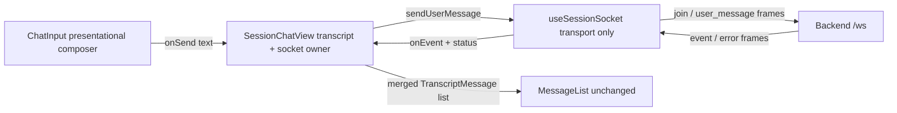
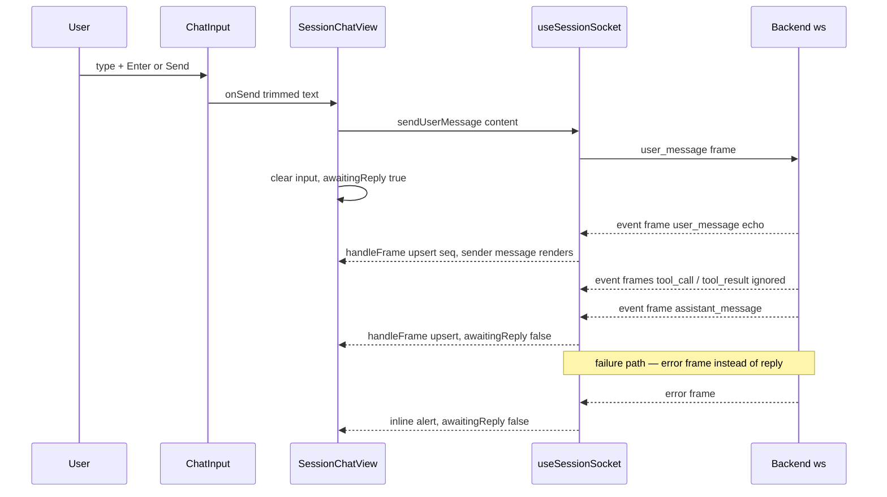

# Chat Input Component — Design (issue #44)

**Date:** 2026-11-23
**Branch:** `feature/chat-input-component` · **PR:** https://github.com/Svagtlys/Octave/pull/154
**Goal:** Give `SessionChatView` (issue #43) a working composer — auto-growing
text area + send button, Enter-to-send / Shift+Enter-for-newline — wired to the
shipped backend send path (WS `user_message` frame, issue #60) so a sent message
appears in the transcript via the hub echo and the agent reply renders when it
arrives. Attachments are **deferred** (Decision 1).

## Context

The send path exists end-to-end on the backend; only the frontend composer is
missing:

- [`_handle_user_message()`](../../backend/src/octave/websocket/connection.py)
  accepts `{"type": "user_message", "session_id", "content"}`, runs the full
  turn through `build_message_router`, commits, then broadcasts every new
  transcript event (including the sender's own `user_message` echo) to joined
  sockets as `{"type": "event", "session_id", "seq", "kind", "author",
  "content"}` (#60 Decision 5). A `StopReason.ERROR` additionally sends the
  driving socket `{"type": "error", "error": str}`.
- The `join` frame registers the socket with the `SessionHub`; a
  `user_message` for an unjoined-but-allowed session still works (the handler
  re-checks `_may_join`), but broadcast delivery requires `join`.
- The broadcast frame carries **no `timestamp`** and includes **non-chat kinds**
  (`tool_call` / `tool_result` / `system` / `context_injection`).
- [`useWebSocket`](../../frontend/src/lib/api/useWebSocket.ts) is generic
  single-`lastMessage` transport with **zero consumers** (regex-verified) —
  wrong shape for chat: last-write-wins state drops frames when a turn
  broadcasts several events in one tick.
- [`SessionChatView`](../../frontend/src/views/SessionChatView.tsx) owns
  transcript state (newest-page fetch + `before_seq` prepend, #43) and renders
  `MessageList`, which keys rows by `seq` and defensively re-sorts.
- Styling is CSS Modules + design tokens (ADR-0001); `Textarea` and `Button`
  primitives exist. TanStack Query is **not** in `package.json` — #43 shipped
  plain fetch + `useState`, and this design follows that precedent.

## Decisions

| # | Decision | Alternatives rejected |
|---|----------|-----------------------|
| 1 | **Attachments deferred.** #44 ships text area + send button only; the composer is attachment-free. A follow-up issue owns the upload endpoint, the `user_message` payload `attachments` field, and composer wiring. | UI-only affordance that transmits nothing (a dead control that lies about capability — rejected in brainstorm in favor of honest scope); full vertical slice (upload endpoint + payload schema) — grows a frontend issue into a backend contract change on shipped `EventStore` validation. |
| 2 | **New `useSessionSocket(sessionId)` hook replaces the unused `useWebSocket`** (old hook + its test deleted). The hook is transport-only: open, auto-`join` on mount and after every reconnect, typed send/receive, `status`, capped exponential-backoff reconnect (the existing idiom), stale-frame guard on `sessionId` change. | Keeping both hooks (dead code for a hypothetical consumer — YAGNI); retrofitting `useWebSocket` in place (rewrites ~90% of the file anyway while forcing the generic API's tests to mutate too; `useSessionSocket` is the honest name for a session-scoped hook). |
| 3 | **View-owned socket + presentational composer** (no context/provider, no TanStack Query). `SessionChatView` mounts the hook, merges `onEvent` frames into its existing `messages` state, and renders `ChatInput` with an `onSend` callback. `ChatInput` holds only its own text state. | `ChatSessionProvider` context above the router (exactly one consumer today; #45 can lift the hook without a provider); TanStack Query as event sink via `setQueryData` (the dependency isn't installed — introducing it mid-chain is scope creep against #43's plain-fetch precedent). |
| 4 | **Echo-driven rendering + waiting status — no optimistic append.** Send clears the input and sets `awaitingReply`; the user's message renders when its echo arrives (near-instant on localhost — the hub broadcast fires immediately after commit); "Agent is thinking…" `role="status"` row shows until an `assistant_message` merges or an `error` frame lands. | Optimistic append with temp keys (needs temp→`seq` reconciliation and duplicate-render heuristics; the backend echo is the designed source of truth — #60 Decision 5 says UIs reconcile against the transcript); pure echo with no indicator (multi-second inference silence reads as broken). |
| 5 | **Merge = filter + dedupe-by-`seq` upsert.** Only `kind ∈ {user_message, assistant_message}` enter `messages` (mirrors the endpoint's filter authority — `tool_call`/`tool_result`/`system`/`context_injection` frames are ignored for rendering); an arriving `seq` already present is dropped; the list stays `seq`-ordered (`MessageList`'s defensive `sortBySeq` stays). | Rendering all kinds (would leak tool noise into the transcript UI #43 deliberately filters server-side); last-write-wins replacement of the message list (drops the paginated older pages). |
| 6 | **Synthesized receive-time timestamp on echo frames.** The broadcast has no `timestamp`; the frontend stamps `new Date().toISOString()` at receive. Authoritative timestamps return on reload via the transcript API. | Extending the backend broadcast frame with `timestamp` (a backend contract change outside this frontend issue; the echo stamp is close enough for a live view and self-heals on reload). |
| 7 | **Reconnect resyncs via `loadLatest()`.** When `status` transitions to `open` after having been non-open (reconnect), the view re-fetches the newest page — events missed while disconnected are recovered by replacing the window. | Replaying missed frames (the hub is fire-and-forget, no replay guarantee); doing nothing (silent transcript gaps). |
| 8 | **E2E pins the send-echo round-trip only.** `chat.spec.ts` (real backend, probe-skip idiom): authed session → type → Send → own message appears via WS echo; waiting/error UI settles. No assistant-reply assertion (a live inference engine can't be assumed). | Full E2E with assistant reply (CI-dependent leg on Ollama availability); unit tests only (the join→send→echo round-trip stays unpinned). |

## Architecture



New files:

- `frontend/src/lib/api/useSessionSocket.ts` — session-scoped WS transport hook
- `frontend/src/components/chat/ChatInput.tsx` + `ChatInput.module.css` — composer
- `frontend/tests/lib/useSessionSocket.test.ts`
- `frontend/tests/components/ChatInput.test.tsx`

Edited files:

- `frontend/src/views/SessionChatView.tsx` + `SessionChatView.module.css` —
  mount hook, merge events, waiting status, render composer
- `frontend/tests/views/SessionChatView.test.tsx` — socket-stubbed merge/waiting tests
- `frontend/tests/e2e/chat.spec.ts` — send-echo leg

Deleted files:

- `frontend/src/lib/api/useWebSocket.ts`
- `frontend/tests/lib/useWebSocket.test.ts`

Unchanged: `MessageList.tsx` (composer-free), `lib/api/sessions.ts`, all
backend code, `docs/API.md` (no contract change).

## Components

### `src/lib/api/useSessionSocket.ts`

```ts
export type SocketStatus = 'connecting' | 'open' | 'closed' | 'error';

/** One broadcast transcript event frame (backend connection.py). */
export interface SocketEvent {
  type: 'event';
  session_id: string;
  seq: number;
  kind: string;
  author: string | null;
  content: string | null;
}

/** One backend error frame. */
export interface SocketError {
  type: 'error';
  error: string;
}

export interface UseSessionSocket {
  status: SocketStatus;
  /** Sends {"type":"user_message","session_id","content"}; no-op unless open. */
  sendUserMessage: (content: string) => void;
}

/**
 * Session-scoped WS transport. `onFrameRef` is a caller-owned ref holding the
 * frame sink — called for every `event` and `error` frame that matches the
 * current session.
 */
export function useSessionSocket(
  sessionId: string,
  onFrameRef: React.RefObject<(frame: SocketEvent | SocketError) => void>,
): UseSessionSocket;
```

Design notes (exact shape may flex slightly in implementation as long as the
contract holds):

- The handler is held in a caller-owned ref (`handlerRef`) so re-renders never
  re-open the socket and the hook never needs handler-identity discipline. The
  view keeps `messages` in a ref mirror for the merge.
- URL derived like the old hook (`VITE_API_URL` → `ws(s)://…/ws`).
- On `open`: send `{"type":"join","session_id"}` immediately (mount and every
  reconnect). The `joined` ack is not required before `sendUserMessage` works
  (the backend re-checks access per frame), so no ack-gating.
- Reconnect: capped exponential backoff (1s → 8s, existing idiom), only while
  the hook is mounted.
- `sessionId` change: close, reset, reconnect + join for the new session;
  frames whose `session_id` doesn't match the current prop are dropped
  (stale-frame guard, mirrors `SessionChatView`'s `requestRef` idiom).
- `status === 'error'` on socket error; a server close (e.g. 4403) lands as
  `closed`. The status transition `non-open → open` is surfaced for Decision 7
  (the view tracks the previous status to detect reconnects).

### `src/components/chat/ChatInput.tsx`

```ts
export interface ChatInputProps {
  /** Called with the trimmed text on send; input clears. */
  onSend: (text: string) => void;
  /** Composer + button disabled (socket not open). */
  disabled: boolean;
}
```

- `Textarea` (rows=1, `max-height` via module CSS, auto-grow on input) +
  `Button` (primary, icon-less "Send") in a flex row — CSS Module, tokens only.
- `onKeyDown`: Enter without Shift → prevent default + send; Shift+Enter →
  default newline. Send is suppressed when `disabled` or `text.trim()` is empty.
- `aria-label="Message input"` on the textarea; the button's accessible name is
  "Send". Text state is internal; cleared after every send.
- No attachment affordance (Decision 1).

### `src/views/SessionChatView.tsx` (edit)

- Mount `useSessionSocket(sessionId, handlerRef)`; fetch lifecycle (#43)
  untouched.
- `handleFrame(frame)` (in the ref):
  - `error` frame → `setError(describeSocketError(frame.error))`,
    `setAwaitingReply(false)`.
  - `event` frame with `kind ∉ {user_message, assistant_message}` → ignored
    (Decision 5).
  - otherwise upsert by `seq` (drop duplicates), map to `TranscriptMessage`
    with `timestamp = new Date().toISOString()` (Decision 6);
    `kind === 'assistant_message'` → `setAwaitingReply(false)`.
- `onSend(content)`: `sendUserMessage(content)` + `setAwaitingReply(true)`.
- Reconnect resync (Decision 7): track previous `status`; on `non-open → open`
  (after the first open), call `loadLatest()`.
- Render (below `MessageList`, inside the scroll container):
  - `awaitingReply` → `<p role="status">Agent is thinking…</p>`
  - `status !== 'open'` → subtle "Disconnected — retrying…" status text
  - `error` → existing `inlineError` `role="alert"` idiom (shared with fetch
    errors).
- Empty-state copy updates: `MessageList`'s "No messages yet" stays; the
  composer renders beneath it so a first message is possible.
- Loading/error-full-page states (#43 gates) render before the composer —
  the composer only appears in the ready transcript.

## Data Flow (one turn)



## Error Handling

| Condition | UI |
|---|---|
| Socket `connecting` / `closed` / `error` | Composer `disabled`; "Disconnected — retrying…" status text; fetch-driven error UI (#43) untouched |
| `error` frame (pipeline not configured / turn failure) | `role="alert"` inline row (existing `inlineError` idiom); `awaitingReply` cleared; composer stays usable |
| Send while not open | Button disabled; Enter is a no-op; `sendUserMessage` no-ops defensively |
| Empty / whitespace-only message | Not sent (button disabled, Enter no-op, trim guard) |
| 4403 close (foreign session) | Socket `closed` → composer disabled + disconnected text; the REST path already rendered the 403 error |
| Echo `seq` already in the window (duplicate broadcast / overlap with fetched page) | Dropped by dedupe-upsert |
| `sessionId` switch mid-flight | Hook re-opens for the new session; frames with a stale `session_id` dropped; #43's `requestRef` guard still owns fetch races |
| Events missed while disconnected | `loadLatest()` resync on reconnect (Decision 7) |

## Testing

**`tests/lib/useSessionSocket.test.ts` (new)** — fake `WebSocket` class on
`globalThis` (jsdom), controllable readyState/fire:

- open → `join` frame sent with the `session_id`.
- `sendUserMessage` while open → `{"type":"user_message","session_id","content"}`.
- `sendUserMessage` while not open → no send.
- `event` / `error` frames → handler called with the parsed frame; `pong` and
  unknown frames ignored.
- socket close → `status: 'closed'`; backoff reconnect (fake timers) then
  re-`join`.
- `sessionId` change → old socket closed, new join sent; stale-`session_id`
  frames not surfaced.
- unmount → socket closed, no reconnect timer.

**`tests/components/ChatInput.test.tsx` (new)** — testing-library + user-event:

- renders textarea (`aria-label`) + Send button.
- Enter sends trimmed text and clears; Shift+Enter inserts a newline (no send).
- empty / whitespace-only → no `onSend` call.
- `disabled` → textarea and button disabled; Enter suppressed.

**`tests/views/SessionChatView.test.tsx` (extend)** — `vi.mock` the socket hook
(capture the handler ref + status setter):

- ready state renders the composer below the transcript.
- `onSend` → hook `sendUserMessage` called; thinking status appears.
- `user_message` event frame → message rendered (echo-driven); `assistant_message`
  frame → thinking row gone.
- `tool_call` / `system` frames → not rendered.
- duplicate `seq` → still one row.
- `error` frame → `role="alert"` visible, thinking row gone.
- status `closed` → composer disabled + disconnected text.
- non-open → open transition (after first open) → `fetchLatestMessages`
  re-called.

**`tests/e2e/chat.spec.ts` (extend)** — real backend, probe-skip idiom, serial
leg after the existing pair: log in → open (or create) a session → type into
the composer → click Send → assert the sent text appears in the transcript
(WS echo) and no `role="alert"` blocks it; do not assert an assistant reply.

**Gates** (from `frontend/`): `npm run test && npm run lint &&
npm run format:check && npm run build` (tsc -b strict — no `any`).

## Out of Scope

- **Attachments** — follow-up issue to file during implementation: upload
  endpoint + `user_message` payload `attachments` schema + composer affordance.
- Token-by-token streaming (#10 / #45).
- `before_seq` chat-open UX refinements (#43 follow-up list unchanged).
- Multi-worker broadcast (post-1.0, #60 recorded).
- Message-bubble delivery states (sending/failed) — echo-driven rendering has
  no per-message delivery lifecycle.
- Backend changes of any kind (frame schema, broadcast `timestamp`).

## Consequences

- First real consumer of the #60 WS pipeline from the UI; the
  `user_message`/`event`/`error` frame contract is now pinned by frontend
  tests — a frame-shape change on the backend will break `useSessionSocket`
  tests loudly rather than silently.
- `useWebSocket`'s deletion leaves exactly one WS hook with one consumer; the
  next consumer (e.g. #45 or a global status socket) re-derives the generic
  version if and when it needs one.
- The synthesized echo timestamp is a known, self-healing inaccuracy (reload
  restores authoritative timestamps); revisit when the backend frame grows a
  `timestamp` field.
- `SessionChatView` now owns fetch + socket + merge; if it grows further
  (streaming, attachments), extract a `useTranscript(sessionId)` reducer hook —
  recorded, not preemptively built.
