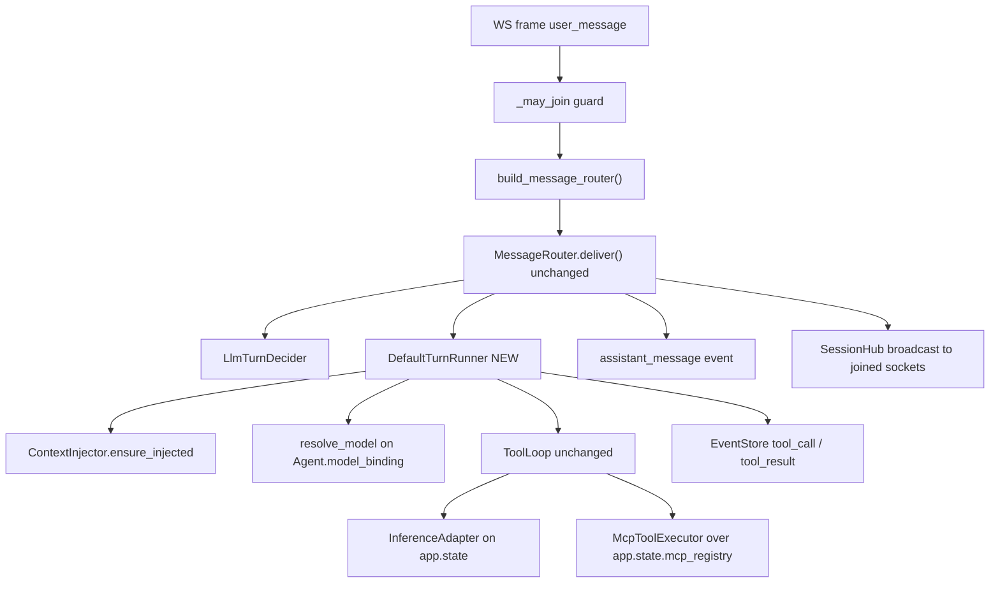

# Wire the End-to-End Request Flow — Design (issue #60)

**Date:** 2026-11-23
**Branch:** `feature/wire-e2e-request-flow` · **PR:** https://github.com/Svagtlys/Octave/pull/153
**Goal:** Compose the shipped stages — WS user message → context assembly →
inference → MCP tool calls → response — into one working request flow, and
verify each stage passes data correctly. This is "Integration #1" named in
`agent/router.py`: the production `TurnRunner`, the WS entry point, the
composition root, and the verification suite.

## Context

Every stage exists but nothing connects them:

| Piece | State |
|---|---|
| `ContextInjector` (`context/injection.py`) | shipped — idempotent session-start injection, budget guard |
| `ToolLoop` (`agent/loop.py`) | shipped — completions + tool rounds over `InferenceAdapter` + `ToolExecutor` |
| `McpToolExecutor` (`agent/mcp_executor.py`) | shipped — `ToolRegistry`-backed, Tier-1 failures → error outcomes |
| `MessageRouter` (`agent/router.py`) | shipped — but the `TurnRunner` port has **no production implementation** ("Integration #1's composition") |
| `websocket_endpoint` (`websocket/connection.py`) | join/echo hub only — no `user_message` handling, no broadcast |
| Composition root | nothing builds decider → manager → registry → runner; the inference adapter is not on `app.state` at all |

Key facts the design leans on:

- [`TurnRunner`](../../backend/src/octave/agent/router.py) is the port:
  `run_turn(*, instance: RunningAgent, messages: list[Message]) -> str`. The
  router claims the turn (`begin_turn`), calls the runner, appends the
  `assistant_message` event, releases — and computes the `TurnRecord` seq
  bracket expecting the runner to append `tool_call`/`tool_result` events
  inside it ("tool calls/results once Integration #1 lands").
- [`EventStore.append`](../../backend/src/octave/db/event_store.py) validates
  only `user_message`/`assistant_message`/`context_injection` payloads;
  `tool_call`/`tool_result` pass through as dicts (existing contract).
- [`_transcript_messages`](../../backend/src/octave/agent/router.py) skips
  non-message kinds — tool events never pollute chat history or the decider tail.
- `translate_tools(inventory)` → `ProviderToolset{tools, routes}` is the
  shipped translation seam (`octave.tools`); `smoke_agent_loop.py` proves
  adapter + registry + loop work together out-of-band.
- `resolve_model` / `resolve_binding` (`db/binding.py`) map an agent's
  `model_binding` to a concrete `(adapter, model)`; tag misses fail loud.
- WS identity is cookie-resolved at handshake (`_resolve_identity`), join is
  guarded by `_may_join` (owner or live participant); the WS scope owns its
  transient `AsyncSession` and commits its own transactions.
- Plane-import direction is enforced: `context` must never import `agent`
  (2026-09-30 ADR Decision 9); `agent → context` is sanctioned.
- Stores never commit; callers own transaction boundaries (`VaultStore`
  convention, restated across `db.deps`, `EventStore`, `MessageRouter`).

## Decisions

| # | Decision | Alternatives rejected |
|---|----------|-----------------------|
| 1 | **Backend-only scope.** Production runner + WS entry + broadcast + tests + manual smoke script. The frontend send path stays with #44/#45. | Including a minimal chat-input UI (couples two issues, and #44/#45 already own the surface); HTTP `POST /messages` entry (diverges from `architecture.md`'s documented WS lifecycle and blocks a request for a whole turn). |
| 2 | **`DefaultTurnRunner` in `octave/agent/turn_runner.py`**, constructed with the caller's `AsyncSession` + injected seams (`adapter`, `registry`, optional `tag_lookup`); never commits. `run_turn`: ensure context injection → load `Agent.model_binding` → `resolve_model` → `translate_tools(registry.inventory())` → `ToolLoop.run` → record the tool bracket → return `turn.result.text`. | Lifespan-singleton orchestrator (fights the session-scoped store convention; would rewire per call anyway); a runner that re-implements the loop (duplicates `ToolLoop` and drifts). |
| 3 | **Tool bracket recorded post-loop from `ToolTurn.messages`.** Messages appended beyond the input tail: assistant-with-`tool_calls` → `tool_call` events `{tool, arguments}`; `role="tool"` → `tool_result` events `{tool, content, is_error}`. `ToolLoop` stays untouched. | Instrumenting `ToolLoop` with a callback (touches shipped, tested code for a recording concern); not recording at all (the MCP stage would leave no transcript evidence — contradicts the `TurnRecord` docstring and "verify each stage passes data correctly"). |
| 4 | **WS `user_message` frame drives a per-frame `MessageRouter`** on a transient `AsyncSession`; the handler commits after `deliver()` (WS scope owns its transaction, precedent `_resolve_identity`). | Per-socket persistent router/session (long-lived session across turns invites stale-identity and transaction-scoping bugs); REST entry (see Decision 1). |
| 5 | **`SessionHub` in `octave/websocket/hub.py`**: in-process `dict[session_id, set[WebSocket]]`, register on join, deregister on disconnect. After each `deliver()`, broadcast every transcript event with `seq >` the pre-delivery max to all joined sockets as `{"type": "event", ...}` — including the sender's own `user_message` (UIs reconcile against the transcript API anyway). | Per-recipient targeting (the chat UI is a session-wide audience); polling the transcript API from the client (defeats the WS hub). **Known limitation, recorded:** single-process fan-out only; multi-worker deployments need a pub/sub backplane — post-1.0. |
| 6 | **Composition helper `build_message_router(session, *, adapter, tool_registry, tag_lookup=None)`** in `octave/agent/composition.py` assembles `LlmTurnDecider` + `AgentInstanceManager` + `AgentRegistry` + `DefaultTurnRunner` → `MessageRouter`. The WS handler calls it per frame. | A `TurnOrchestrator` singleton on `app.state` (Decision 2's objection); wiring the router in `create_app` (the router needs a session per transaction, not per app). |
| 7 | **`inference_lifespan` publishes `app.state.inference_adapter` + `app.state.inference_adapter_name`**, built unconditionally from `InferenceSettings` (the defaults point at local Ollama — local-first posture; a dead engine surfaces as `AdapterError` → router ERROR stop, not a boot failure). The WS `user_message` path treats a missing/`None` `app.state.inference_adapter` as "not configured" → `{"type": "error"}` frame (mirrors the MCP 503 posture; tests exercise it by setting the state to `None`). Adapter selection for 1.0: the single configured adapter; a resolved binding naming a *different* adapter fails loud (`ModelBindingError`). | Failing startup when no engine is reachable (Octave boots fine without MCP servers; inference follows the same posture); multi-adapter resolution table (no second adapter exists; speculative); silent fallback to the default adapter on name mismatch (hides misconfiguration — the binding-resolution ADR says fail loud). |
| 8 | **Agents are DB-seeded, not API-created, in tests and the smoke script.** No agent-CRUD surface in scope. | Building an agent API inside this issue (separate concern, no issue owns it yet — the smoke script seeds `agents` rows directly like `smoke_agent_loop.py` wires seams directly). |
| 9 | **Context injection failure (budget exceeded, unresolvable binding) propagates** — the router already converts runner exceptions into a `system` event + `StopReason.ERROR`. The `ContextBudgetExceededError` drop-hint lands in the system event content. | Catching inside the runner and answering without context (silently drops user-configured standing context; the budget ADR wants the failure visible). |

## Architecture



New files:

- `backend/src/octave/agent/turn_runner.py` — `DefaultTurnRunner`
- `backend/src/octave/agent/composition.py` — `build_message_router`
- `backend/src/octave/websocket/hub.py` — `SessionHub`
- `backend/scripts/smoke_e2e_flow.py` — manual end-to-end smoke

Edited files:

- `backend/src/octave/websocket/connection.py` — `user_message` frame + hub
- `backend/src/octave/app.py` — add `inference_lifespan` (or an
  `octave/inference/lifespan.py` mirroring `mcp/lifespan.py`)
- `backend/src/octave/agent/__init__.py` — export `DefaultTurnRunner`,
  `build_message_router`

Unchanged: `agent/loop.py`, `agent/router.py`, `context/injection.py`,
`db/event_store.py` (contract already permits the new event kinds).

## Components

### `octave/agent/turn_runner.py`

```python
class DefaultTurnRunner:
    """Production TurnRunner (Integration #1): context injection +
    ToolLoop + transcript tool bracket. Never commits."""

    def __init__(
        self,
        session: AsyncSession,
        *,
        adapter: InferenceAdapter,
        registry: ToolRegistry,
        adapter_name: str | None = None,
        tag_lookup: Callable[[str], str | None] | None = None,
    ) -> None: ...

    async def run_turn(
        self, *, instance: RunningAgent, messages: list[Message]
    ) -> str: ...
```

`run_turn` steps:

1. `ContextInjector(session).ensure_injected(session_id=instance.session_id,
   agent_id=instance.agent_id)` — idempotent; second turn short-circuits.
2. Load `Agent` row; `resolve_model(agent.model_binding,
   tag_lookup=self._tag_lookup)` → `ResolvedModel`.
   If `resolved.adapter` is set and differs from the configured adapter's
   name → `ModelBindingError` (fail loud, Decision 7).
3. `toolset = translate_tools(await registry.inventory())`.
4. `turn = await ToolLoop(adapter=adapter, executor=McpToolExecutor(registry),
   ...).run(messages, toolset, model=resolved.model)`.
5. Record the bracket: iterate `turn.messages[len(messages):]` —
   assistant message with `tool_calls` → one `tool_call` event per call
   (`{"tool": name, "arguments": call.arguments or "{}"}` — the verbatim
   arguments string, lossless and debuggable);
   `role == "tool"` → one `tool_result` event
   (`{"tool": name, "content": content, "is_error": bool}`).
   The loop's final assistant message (no `tool_calls`) is **skipped** —
   the router records it as `assistant_message`; a duplicate would corrupt
   the transcript. Author = the agent's participant (looked up via
   `Participant.agent_id`, the `archiver.py::_labels()` join precedent;
   events keep `kind` verbatim).
6. Return `turn.result.text`.

### `octave/agent/composition.py`

```python
def build_message_router(
    session: AsyncSession,
    *,
    adapter: InferenceAdapter,
    tool_registry: ToolRegistry,
    adapter_name: str | None = None,
    tag_lookup: Callable[[str], str | None] | None = None,
    max_agent_turns: int = 4,
) -> MessageRouter:
    """Assemble decider + manager + registry + runner into the driver.
    Pure wiring: no I/O, no app.state reads (callers resolve seams)."""
```

### `octave/websocket/hub.py`

```python
class SessionHub:
    """In-process fan-out registry: session_id -> joined websockets.
    Register on join, deregister on disconnect. Broadcast is best-effort:
    a dead socket is dropped, never fails the transcript write."""

    def join(self, session_id: str, ws: WebSocket) -> None: ...
    def leave(self, session_id: str, ws: WebSocket) -> None: ...
    async def broadcast(self, session_id: str, payload: dict) -> None: ...
```

Created lazily on `app.state.ws_hub` by a `get_hub(app)` helper (the WS
router has no lifespan; lazy creation keeps `app.py` untouched for the hub
and gives tests a fresh hub per app instance).

### `octave/websocket/connection.py` (edit)

New frame: `{"type": "user_message", "session_id": str, "content": str}`.

1. `_may_join(user_id, session_id)` — false → close `4403` (mirrors join).
2. Resolve the caller's participant (`SessionStore.get_participant_for_user`
   — the same lookup `routes/sessions.py::_require_participant_id` uses).
3. `getattr(app.state, "inference_adapter", None)` — `None` → send
   `{"type": "error", "error": "inference not configured"}`, socket stays open.
4. Transient `AsyncSession`; `build_message_router(...)`;
   `outcome = await router.deliver(session_id,
   author_participant_id=participant_id, content=content)`; **commit**.
5. Broadcast: read events with `seq > max_seq_before_delivery` (computed
   inside the same transaction before `deliver`), send each joined socket
   `{"type": "event", "session_id": ..., "seq": ..., "kind": ...,
   "author": <label or null>, "content": ...}`.
6. `outcome.stop_reason == ERROR` → additionally send the driving socket
   `{"type": "error", "error": outcome.error}`.
7. `join` also registers with the hub; `pong` echo preserved.

### `octave/app.py` (edit) + inference lifespan

`octave/inference/lifespan.py`: `inference_lifespan(app)` builds the adapter
unconditionally from `InferenceSettings().to_adapter_config()` via
`default_registry.create(...)` (mirroring `smoke_inference.py` wiring),
publishes `app.state.inference_adapter` and
`app.state.inference_adapter_name`, and `aclose()`s it on shutdown.
Composed into `app`'s lifespan stack. Tests override the state attributes
with fakes (precedent: `DummyHasher` / `auth_settings`).

## Data Flow (one turn)

```mermaid
sequenceDiagram
    participant C as Client (WS)
    participant WS as websocket_endpoint
    participant RT as MessageRouter
    participant TR as DefaultTurnRunner
    participant CI as ContextInjector
    participant TL as ToolLoop
    participant MCPS as MCP Server
    C->>WS: user_message frame
    WS->>WS: _may_join + participant resolve
    WS->>RT: deliver(session, participant, content)
    RT->>RT: append user_message event
    RT->>TR: run_turn(instance, transcript)
    TR->>CI: ensure_injected (once per session+agent)
    TR->>TL: run(messages, toolset, model)
    TL->>MCPS: tool call(s)
    TL-->>TR: ToolTurn(final text, messages)
    TR->>TR: append tool_call / tool_result events
    TR-->>RT: reply text
    RT->>RT: append assistant_message event
    RT-->>WS: RouteOutcome
    WS->>C: commit; broadcast event frames to hub
```

## Error Handling

- **No inference adapter:** `error` frame; socket open. (503-posture parity.)
- **Runner failure** (budget exceeded, binding unresolvable, adapter down):
  the shipped router path — `system` event + `StopReason.ERROR`; the WS
  handler adds an `error` frame. The user message event survives (committed
  with the system event — the router's single-transaction contract).
- **MCP tool failure:** Tier-1 inside `ToolLoop` (error tool message, model
  reacts); recorded as `tool_result` with `is_error: true`. Loop-limit:
  `ToolLoopLimitError` → router ERROR stop.
- **Broadcast failure:** best-effort; dead sockets dropped, never rolls back
  the transcript.
- **Malformed frames:** same posture as today (generic close).

## Verification

1. **Runner unit tests** (`tests/agent/test_turn_runner.py`): fake
   `InferenceAdapter` (scripted: first completion returns a tool call, second
   returns final text) + fake `ToolRegistry` + real SQLite session. Asserts:
   `context_injection` event written once (twice-called = no second write);
   `tool_call`/`tool_result` events recorded with correct payloads inside the
   bracket; reply text returned; binding failure raises `ModelBindingError`.
2. **Composition test** (`tests/agent/test_composition.py`):
   `build_message_router` returns a wired router (fakes injected); end-to-end
   `deliver()` over a seeded user/session/agent/instance produces
   `user_message` → `context_injection` → `tool_call` → `tool_result` →
   `assistant_message` in seq order.
3. **WS integration tests** (`tests/test_websocket.py` extension): real app +
   `TestClient` WS with fakes on `app.state` (precedent: `DummyHasher`):
   join → `user_message` → `event` frames received in order and transcript
   persisted; adapter-less error frame; 4403 on a foreign session; hub
   deregistration on disconnect; `pong` regression.
4. **Manual smoke** (`scripts/smoke_e2e_flow.py`): real engine via
   `OCTAVE_INFERENCE_*` env, real stdio filesystem MCP server, temp SQLite DB
   with seeded user/session/agent (explicit binding), in-process ASGI WS
   client. Asserts the full stage chain in the transcript and the tool's side
   effect (file created). Not part of CI, same posture as the other smoke scripts.

## Out of Scope

Frontend send path (#44/#45), agent CRUD API, token streaming (#10),
archival wiring (`ContextArchiver` call sites), multi-worker broadcast
(pub/sub), `every_turn` injection cadence, multi-adapter resolution.

## Follow-ups Recorded

- Shared `session_access` helper for HTTP+WS access checks (third consumer).
- Hub pub/sub seam for multi-worker deployments.
- Wire `ContextArchiver` into the turn boundary (CM #5).
