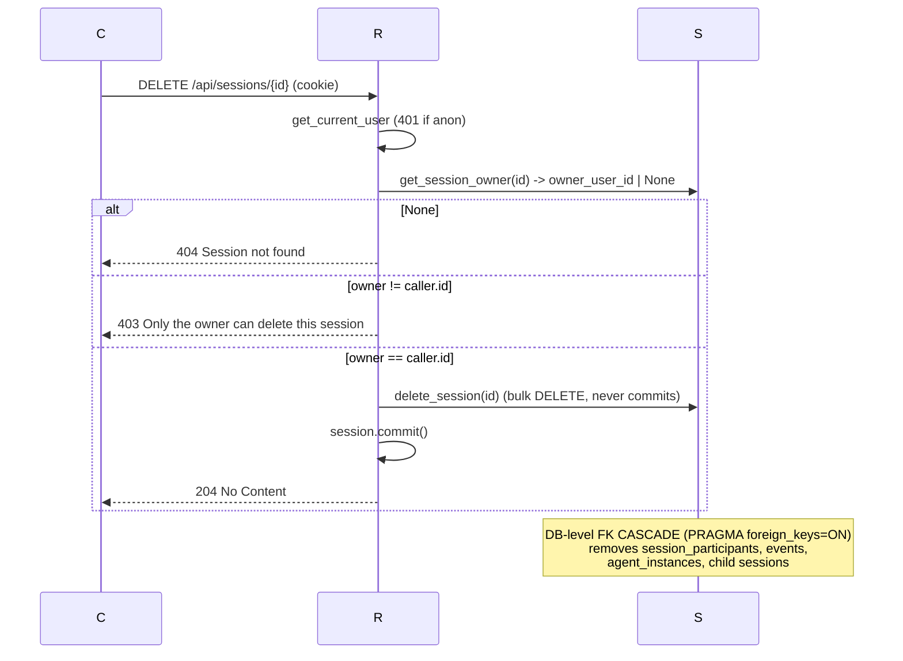

# Delete Session Endpoint — Design (issue #160)

**Date:** 2026-11-26
**Branch:** `feature/delete-session-endpoint` · **PR:** https://github.com/Svagtlys/Octave/pull/164
**Goal:** Backend `DELETE /api/sessions/{id}` — hard delete of the session row with
DB-level FK cascade to `session_participants`, `events`, `agent_instances`, and child
sessions (`parent_session_id`). Owner-only guard; unknown id → 404, non-owner → 403,
success → 204. Unskip the frontend delete e2e in `frontend/tests/e2e/chat.spec.ts`.

## Context

- The frontend delete flow shipped in issue #46 (`feature/conversation-history-management`):
  `deleteSession()` in `frontend/src/lib/api/sessions.ts` is a real `DELETE` call (no fake
  success); `useConversations.remove(id)` updates local state and returns the
  next-most-recent session. Until this endpoint lands, the UI surfaces the server's 404/405.
- The #46 spec deferred this work: "cascade semantics are schema-ready; owner-only guard
  mirrors `resolve_access`." This spec implements it.
- Schema is delete-ready (verified in `octave.db.models`):
  - `session_participants.session_id` → `sessions.id` `ondelete="CASCADE"`
  - `events.session_id` → `sessions.id` `ondelete="CASCADE"` (and the composite
    membership FK `fk_events_target_membership` is `CASCADE`)
  - `agent_instances.session_id` → `sessions.id` `ondelete="CASCADE"`
  - `sessions.parent_session_id` → `sessions.id` `ondelete="CASCADE"` (sub-agent lineage)
  - `sessions.created_by_user_id` → `users.id` `ondelete="RESTRICT"` (user-protected)
  - `create_sqlite_engine` (`octave.db._bootstrap`) sets `PRAGMA foreign_keys=ON` per
    connection, so DB-level cascade is enforced at runtime.
- Access-guard precedent: `GET /api/sessions/{id}/messages` uses
  `SessionStore.resolve_access` → verdicts `missing`/`denied`/`granted` mapped to
  404/403/allow. `resolve_access` grants reads to owner **or** live participant.

## Decisions (user-approved during brainstorming)

1. **Owner-only delete.** Only `sessions.created_by_user_id` may delete. A current
   participant (non-owner) gets 403; unknown id gets 404. Rationale: hard delete destroys
   everyone's transcript; participant semantics elsewhere are "leave" (`left_at`), not
   "destroy". `resolve_access` (read semantics) is deliberately **not** reused for delete.
2. **Repeat delete → 404**, identical to never-existed. Consistent with the existing
   surface (every unknown id answers 404); the frontend calls `remove()` once per user
   action. No tombstones, no idempotent-204 special-casing.
3. **Vault summary cleanup out of scope.** The cached `session_summary:{id}` vault item
   (`octave.agent.summaries`) is derived data; deleting it rides a separate issue if it
   ever matters. This endpoint deletes session rows only.
4. **Implementation shape (Approach A):** dedicated owner guard on `SessionStore` —
   `get_session_owner` + `delete_session` — instead of reusing `resolve_access`
   (3 queries + read semantics) or ORM unit-of-work delete (SELECTs a full object).

## Architecture



### Store additions (`octave.db.session_store.SessionStore`)

Two methods, following the plane contract (**never commits**; routes own transactions)
and the `AuthStore.delete_session_by_hash` idiom:

```python
async def get_session_owner(self, session_id: str) -> str | None:
    """created_by_user_id for the row, or None when absent. HTTP-agnostic."""

async def delete_session(self, session_id: str) -> int:
    """Bulk DELETE of the sessions row by id; returns rowcount. DB-level FK
    CASCADE removes participants/events/agent_instances/child sessions.
    Never commits."""
```

- Bulk `sqlalchemy.delete(Session).where(Session.id == session_id)` with
  `synchronize_session=False` — no ORM object load.
- The store stays HTTP-agnostic: verdicts (owner id / None) cross the boundary; the
  route maps them to status codes, mirroring how `resolve_access` verdicts are handled.

### Route (`octave.routes.sessions`)

```python
@router.delete("/{session_id}", status_code=204)
async def delete_session(session_id, user, session) -> Response: ...
```

- `store.get_session_owner(session_id)` → `None` → `404 "Session not found"`.
- owner `!=` `user.id` → `403 "Only the owner can delete this session"` (exact detail
  string new to this route; 404 detail matches the messages route verbatim).
- Owner: `await store.delete_session(session_id)` → `await session.commit()` → **204**,
  empty body (return `Response(status_code=204)`; no pydantic model).
- 401 comes free from `get_current_user`. Route-owned commit matches
  `create_session` — the `get_db_session` dep rolls back on exception.

### Cascade correctness

Cascade is schema-enforced, not app-enforced: no manual child deletes in the store or
route. Tests pin the contract (below) so a future schema change that drops an
`ondelete="CASCADE"` fails loud. Child sessions (`parent_session_id` self-CASCADE) are
destroyed with the parent — accepted hard-delete semantics for sub-agent lineage.

## Error handling

| Condition | Status | Detail |
| --- | --- | --- |
| No/invalid cookie | 401 | existing `get_current_user` behavior |
| Unknown session id (incl. repeat delete) | 404 | `Session not found` |
| Exists, caller not owner (even live participant) | 403 | `Only the owner can delete this session` |
| Owner deletes | 204 | empty body |

## Testing

**Store tests (`backend/tests/db/test_session_store.py`):**

- `get_session_owner`: hit returns owner user id; miss returns `None`.
- `delete_session`: removes the row and returns rowcount 1; never commits (rollback
  idempotence check mirroring `test_create_session_never_commits`).
- Cascade verification: seed a session with membership rows, events (message + non-message
  kinds), an `agent_instances` row, and a child session (`parent_session_id`); delete the
  parent; assert every child row is gone and unrelated sessions are untouched.

**Route tests (`backend/tests/routes/test_sessions.py`):**

- 401 unauthenticated `DELETE`.
- 404 unknown id.
- 403 for a live non-owner participant (seed via the existing `_create_member` +
  `SessionParticipant` insert idiom from the messages tests).
- 204 for the owner; empty response body.
- After delete: `sessions`, `session_participants`, `events`, and `agent_instances` rows
  for the id are gone (direct DB assertion); `GET /api/sessions` no longer lists it.
- Repeat delete → 404.

**Playwright e2e (`frontend/tests/e2e/chat.spec.ts`):**

- Unskip `deleting a conversation removes it from the panel` and implement against the
  real backend: sign in (serial-owner idiom), create two chats via New chat, delete the
  active one through the confirm modal, assert the row disappears from the panel and
  navigation lands on the next conversation. Probe-skip idiom unchanged.

**Frontend unit tests:** no changes — `deleteSession` is already asserted as a real
DELETE call in `sessions.test.ts`; `useConversations.remove` behavior is unchanged by
this issue.

**Gates:** backend `pytest`; frontend `npm test`, `tsc --noEmit`, eslint, prettier (CI).

## Documentation

- `docs/API.md`: add `DELETE /api/sessions/{id}` — owner-only guard, 204/404/403
  semantics, cascade note.
- `frontend/src/lib/api/sessions.ts`: drop the STUB comment on `deleteSession` now that
  the endpoint exists (comment-only change).

## Out of scope

- Vault cleanup of derived `session_summary:{id}` items (separate issue if needed).
- Soft delete / archive; restore.
- WebSocket broadcast of deletion to other clients or joining clients.
- Cancellation of in-flight agent runs bound to the deleted session
  (`agent_instances` rows are cascade-removed; a running turn may error against the
  missing session — acceptable, matches the #46 frontend decision "backend-side run
  continues (out of scope)").
- `PATCH` (rename), pin, search.

## Consequences

- The frontend delete flow from #46 works end-to-end with zero frontend logic changes
  (only the STUB comment drops).
- `SessionStore` now owns one destructive operation; the never-commit contract and
  HTTP-agnostic verdict style keep it consistent with every other plane store.
- Deleting a parent session destroys sub-agent child sessions via the schema — the
  cascade test pins this so the behavior is explicit, not accidental.
