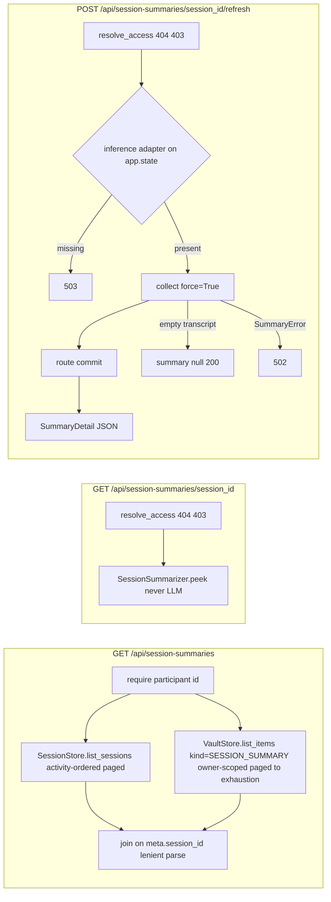

# Session Summary Result Viewer — Design (issue #112)

**Date:** 2026-11-26
**Branch:** `feature/session-summary-result-viewer` · **PR:** https://github.com/Svagtlys/Octave/pull/165
**Goal:** Wire the Agent Manager result viewer to the shipped session-summaries surface.
Backend: `GET /api/session-summaries` (list), `GET /api/session-summaries/{session_id}`
(detail via `SessionSummarizer.peek`), `POST /api/session-summaries/{session_id}/refresh`
(via `collect(force=True)`). Frontend: replace the `/agents` placeholder with a
master–detail result viewer. Tests both planes.

## Context

- `octave.agent.summaries` (issue #28) shipped and is fully tested, but
  `SessionSummarizer` is **never constructed in production code** — only tests.
  This issue's refresh route is its first production trigger.
- Summary storage: one vault item per session, deterministic id
  `session_summary:<session_id>`, `kind=SESSION_SUMMARY`, owned by the session's
  `created_by_user_id`, `meta = {session_id, covered_seq, model_name}`.
  `peek()` reads the cache (never calls the adapter); `collect(force=True)`
  regenerates via LLM and upserts (never commits — the route owns the commit).
- `VaultStore.list_items(user_id=…, kind=…)` is owner-scoped, oldest-first,
  limit/offset paged (default 100).
- Route conventions (`routes/sessions.py`): cookie auth via `get_current_user`,
  `get_db_session` yields a session and rolls back on exception, routes own
  commits, transcript access via `SessionStore.resolve_access`
  (`missing` → 404, `denied` → 403, granted → proceed).
- Composition seams: `app.state.db_adapter` (db_lifespan),
  `app.state.inference_adapter` + `app.state.inference_adapter_name`
  (inference_lifespan). No HTTP-level `adapter_for` seam exists yet.
- Frontend: `/agents` is a `PlaceholderView` route; `lib/api/sessions.ts` +
  `lib/api/useConversations.ts` establish the API-module + list-hook pattern
  (stale-response guard, `describeListError`, `loadOlder`).

## Decisions (user-approved during brainstorming)

1. **List = all the caller's sessions, each with its summary or null.** The
   literal reading of the issue (`list_items(kind=SESSION_SUMMARY)` only) would
   render sessions without a summary invisible — and since nothing generates
   summaries in production yet, the viewer would start permanently empty. The
   list therefore comes from `SessionStore.list_sessions` (activity-ordered,
   paginated) with summaries attached via `VaultStore.list_items` — satisfying
   the issue's surface while keeping it discoverable ("No summary yet" +
   Generate/Refresh affordance).
2. **Backend shape (Approach A): dedicated `/api/session-summaries` router.**
   Rejected: nesting under `/sessions/{id}/summary` (grows `sessions.py` past
   its transcript-lifecycle focus; future `GET /sessions/{id}` shadowing risk)
   and a generic `GET /api/vault?kind=…` (leaks vault plumbing — deterministic
   ids, `meta` parsing — to the frontend, no transcript access control).
3. **Frontend: master–detail on `/agents`, no new route.** Left pane = session
   list; right pane = selected summary detail with Refresh + Open chat.
   Rejected: two routes (`/agents` + `/agents/$sessionId`) — more plumbing for
   no product need yet; a Sessions-hub tab — diverges from the issue's
   "Agent Manager result viewer" framing.
4. **Owner-scoped join, accepted limitation.** Summaries are owned by the
   session *creator* (`created_by_user_id`). The list join fetches
   `list_items(user_id=caller.id)`, so a session the caller *joined* but does
   not own shows "No summary yet" even when the owner has one. Accepted for
   this single-owner-first product; detail/refresh of such a session still
   works (peek/collect resolve the item by deterministic id, and
   `resolve_access` grants participants).
5. **Detail endpoint exists and is used by the view, per the issue.** The list
   carries a truncated `snippet` (route-boundary truncation, mirrors
   `PREVIEW_MAX_CHARS`); the detail carries full `content`. Selecting a row
   fetches detail via `peek` — cheap, never calls the LLM.
6. **No staleness indicator.** A "summary is stale" badge needs the transcript
   max-seq per row (extra query per session, N+1). YAGNI — the user force-
   refreshes. `covered_seq` stays server-side.

## Architecture



### API contract

All routes: `get_current_user` (401 anonymous), `get_db_session`; routes own
commits. Prefix `/api/session-summaries`, tag `summaries`.

**`GET ""`** — query `limit` (1–100, default 20), `offset` (≥0, default 0),
same bounds as `GET /api/sessions`.

1. `_require_participant_id` (route-local helper, same convention as
   `routes/sessions.py`: caller's missing `Participant` row fails loud via
   `OwnerParticipantMissingError` → 500 via the DbError handler; never
   self-healed).
2. `SessionStore.list_sessions(participant_id, limit, offset)` → rows + total.
3. `VaultStore.list_items(user_id=user.id, kind=SESSION_SUMMARY)` **paged to
   exhaustion** (the `injection._corpus` pattern — a silent 100-item cap would
   drop summaries from the join, a correctness cliff).
4. Join in memory: parse each item via the same lenient rule as
   `summaries._to_summary` (malformed `meta` → treated as absent; item whose
   `meta.session_id` is missing/mismatched is skipped). Map
   `session_id → summary`.
5. Response envelope `{items, total, limit, offset}` where each item:

```json
{
  "id": "s_1",
  "title": "Weather check",
  "created_at": "...",
  "last_activity": "...",
  "last_message": "truncated preview ≤140 chars or null",
  "summary": {
    "title": "Weather check",
    "snippet": "truncated body ≤140 chars",
    "model_name": "llama-3.1",
    "generated_at": "..."
  }
}
```

`summary` is `null` when absent. Session fields mirror `SessionResponse`
(`last_message` reuses the same `_preview` route-boundary truncation).

**`GET /{session_id}`** — `resolve_access` gate (404 unknown / 403 non-member),
then `peek`. Response `{"session_id": "...", "summary": SummaryDetail | null}`
with `SummaryDetail = {title, content, model_name, generated_at}` (full
content, no snippet).

**`POST /{session_id}/refresh`** — `resolve_access` gate, then
`collect(session_id, force=True)` + `session.commit()`.

- Empty transcript → `collect` returns `None` → `200 {"session_id": …,
  "summary": null}` (nothing to summarize, not an error).
- `app.state.inference_adapter` missing → `503` (boot posture mirrors
  `get_mcp_manager`; Octave runs fine without inference — list/detail still
  work, only refresh 503s).
- `SummaryError` (adapter failure / empty completion) → `502` with detail
  string (upstream engine failure, distinct from an Octave bug).
- `SessionNotFoundError` → `404` (defensive; the gate normally covers it).
- Success → `200` with the full `SummaryDetail`.

### Composition wiring (`octave/agent/composition.py`)

New pure-wiring helper beside `build_message_router`:

```python
def build_session_summarizer(
    session: AsyncSession,
    *,
    db_adapter: DbAdapter,
    adapter: InferenceAdapter,
    adapter_name: str | None = None,
    tag_lookup: Callable[[str], str | None] | None = None,
) -> SessionSummarizer:
    """Wire the summarizer to the single configured inference adapter.
    Binding: explicit adapter/default-model pair from the adapter's config
    (empty model string falls through to the adapter's own default at
    request time). adapter_for guards the name match, mirroring
    DefaultTurnRunner's binding check: mismatch raises ModelBindingError."""
```

- `binding = ExplicitModelBinding(kind="explicit", adapter=adapter_name or
  "openai", model=adapter.config.default_model or "")`.
- `adapter_for = lambda name: adapter if name == (adapter_name or "openai")
  else raise ModelBindingError(...)`.
- Routes construct the summarizer per request via this helper (the
  `build_message_router` precedent: callers resolve seams from `app.state`,
  tests inject fakes).

### Router mounting (`octave/app.py`)

`app.include_router(summaries_router, prefix="/api")` after `sessions_router`.

## Frontend

- **`lib/api/summaries.ts`** — types (`SummaryDetail`, `SummaryListItem`,
  `SessionSummaryListPage`, `SessionSummaryDetailResponse`) +
  `fetchSessionSummaries(limit, offset)` and
  `refreshSessionSummary(sessionId): Promise<SessionSummaryDetailResponse>`.
  Uses `client.ts` `get`/`post`; 401 interceptor rides along.
- **`lib/api/useSessionSummaries.ts`** — cloned `useConversations` shape:
  `{ items, state, error, hasMore, loadingOlder, refresh, loadOlder,
  regenerate }`. `regenerate(sessionId)` POSTs refresh, patches that row's
  `summary` in place (ref + state, same discipline as `sessionsRef`), throws
  on failure (the detail view surfaces the error inline).
- **`views/AgentsView.tsx`** + `AgentsView.module.css` — master–detail:
  - Left: list rows (session `title` or "Untitled", summary `snippet` or
    "No summary yet", `generated_at` when present), selection highlight,
    "Load older" pagination, loading/error/empty states.
  - Right: on selection, `GET detail` (peek) → full title, body, meta line
    (`model_name` · generated date), **Refresh** button (disabled + spinner
    label while in flight; success patches detail + list row; failure inline
    error), **Open chat** link → `/sessions/$sessionId`. No summary →
    "No summary yet" + Generate button (same POST refresh path).
  - Empty list state: "No conversations yet."
- **`router.tsx`** — `agentsRoute.component` swaps `PlaceholderView` →
  `AgentsView`; `staticData.title` stays "Agents". No new routes.

## Error handling

| Condition | Status | Frontend |
|---|---|---|
| Anonymous | 401 | interceptor → login |
| Unknown session (detail/refresh) | 404 | inline error |
| Non-member (detail/refresh) | 403 | inline error |
| Inference adapter unconfigured (refresh only) | 503 | inline "Summarization not configured" |
| `SummaryError` (refresh) | 502 | inline "Couldn't generate summary (502)." |
| Empty transcript (refresh) | 200 + null | "Nothing to summarize yet." |
| Missing `Participant` row | 500 (DbError handler) | generic list error |

## Testing

**Backend** — `backend/tests/routes/test_summaries.py` (new, reuses the
`_sessions_app`-style harness plus `app.state.db_adapter` +
`app.state.inference_adapter` with a scripted fake):

1. 401 on all three endpoints when anonymous.
2. List: summary attached to the owning session; `null` when absent;
   pagination bounds echo; owner scoping — another user's summaries never
   leak into the join; malformed-meta items treated as absent; more than 100
   summaries (paging-to-exhaustion correctness).
3. Detail: 404 unknown, 403 non-member, 200 with full content, `null` summary
   when none cached; peek never calls the adapter (fake with empty script →
   no exception).
4. Refresh: happy path — scripted completion → vault item persisted after
   commit (verify in a fresh session), response carries the detail; force
   regenerates over a fresh cache (second call re-invokes the adapter);
   empty transcript → 200 null; `SummaryError` → 502; missing
   `inference_adapter` → 503; 404/403 gate precedes any adapter call.
5. `build_session_summarizer` in `tests/agent/test_composition.py`: binding
   construction from config, `adapter_for` name-match guard, end-to-end
   collect through the helper with a scripted adapter.

**Frontend** — `summaries.test.ts` (client contract: URL, envelope,
`encodeURIComponent`); `AgentsView.test.tsx` (list render incl. "No summary
yet", selection → detail fetch, refresh success patches row + detail, refresh
error inline, Open chat navigates); `useSessionSummaries.test.ts` (stale
guard, `regenerate` patches in place, throws on failure); router test asserts
`/agents` renders the viewer, not the placeholder.

## Out of scope

- Vault item cleanup on session delete (decided out in #160).
- Staleness indicators / auto-summary on session end.
- Multi-owner summary visibility (Decision 4 limitation).
- Agent dashboard / live instance status (separate Agent Manager UI issue).

## Notes

- The design doc is committed on the feature branch alongside the
  implementation (architect mode cannot run git).
